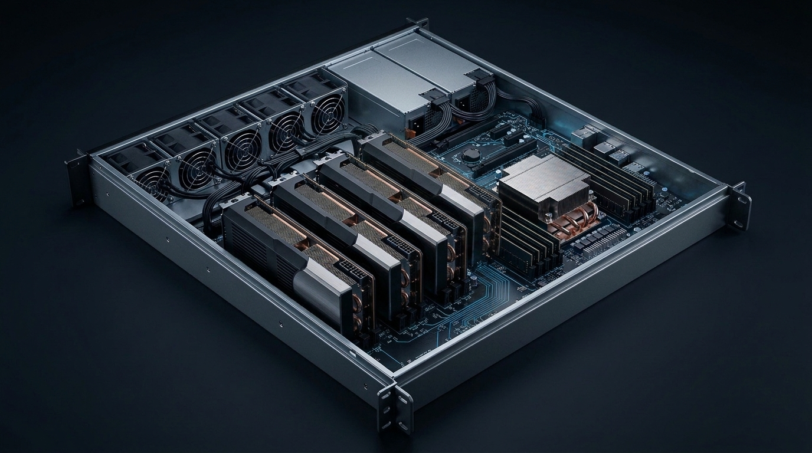
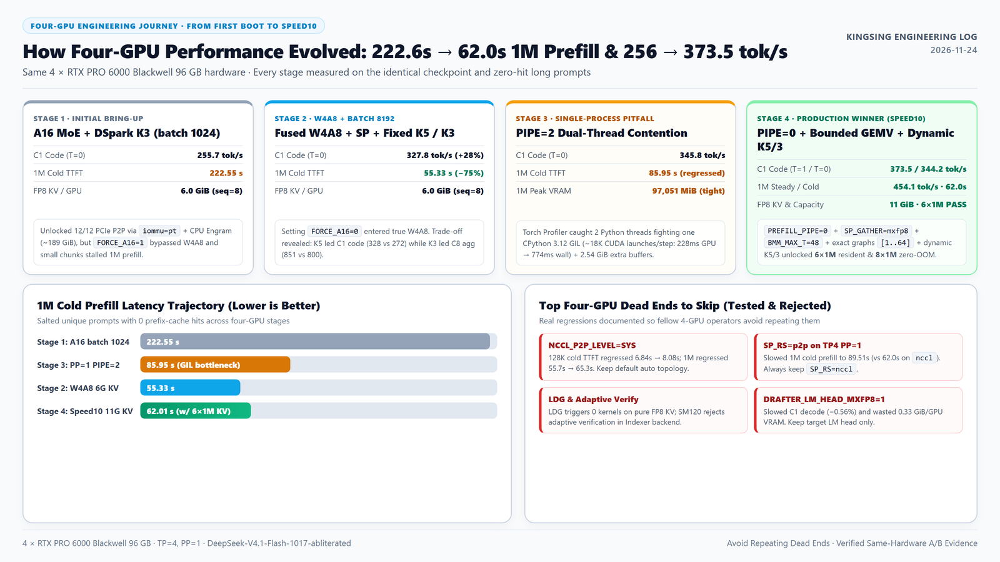
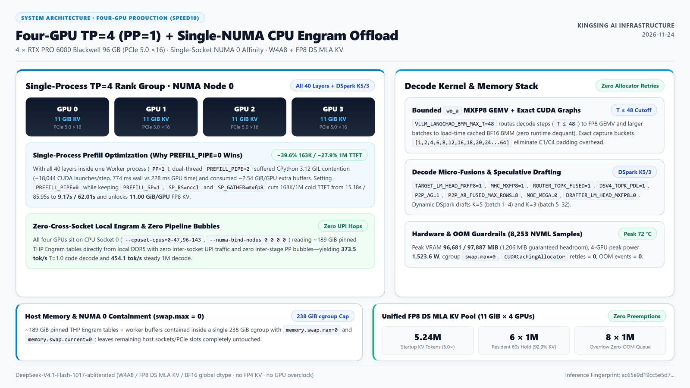
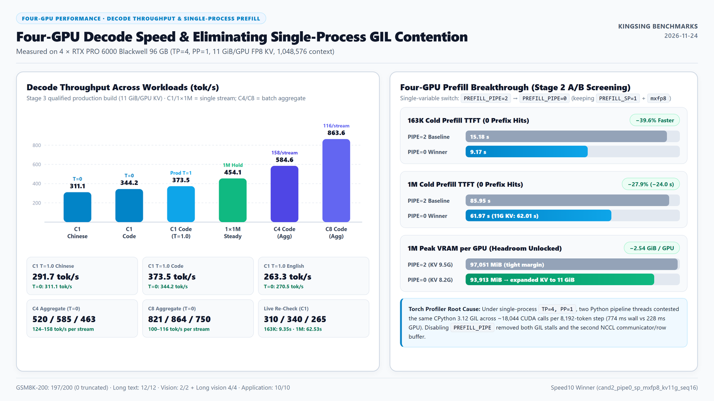
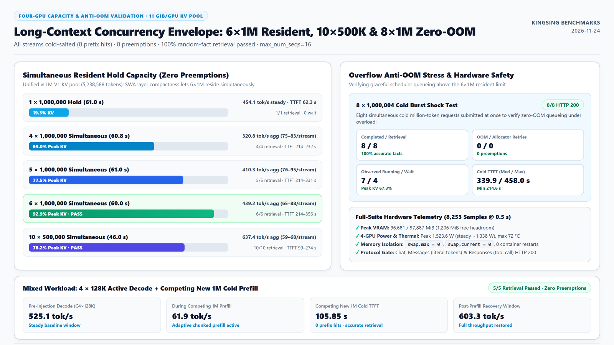

# DeepSeek-V4.1-Flash-1017 on Four RTX PRO 6000 Blackwell 96 GB GPUs — Complete Production Guide

[Original Publication: KINGSING Company News](https://www.kingsing.com/news/KINGSING_DeepSeek_V41_Four_GPU_RTX_PRO_6000_Deployment.html) · [Full English Engineering Guide](docs/four-gpu-deployment-en.md) · [中文完整实战指南](docs/four-gpu-deployment-zh.md)



> **Built for engineers deploying `DeepSeek-V4.1-Flash-1017` on 4 × RTX PRO 6000 Blackwell 96 GB (384 GB total VRAM).** This repository documents every step that took our four-GPU server from initial bring-up (`255.7 tok/s` code, `222.55 s` 1M cold prefill) to production **Speed10** (`373.5 tok/s` code, `454.1 tok/s` 1M steady decode, `62.0 s` 1M cold prefill, **`6×1M` resident concurrency**, and **`8×1M` zero-OOM queueing**)—including every failed tuning attempt and dead end so you don't waste GPU hours repeating them.

---

## Quick Navigation / 快速导航

- [Performance Snapshot](#-performance-snapshot--核心成果一览)
- [How We Got Here: 4-Stage Optimization Journey](#-how-we-got-here-4-stage-evolution--四阶段演进路线)
- [Core Architecture & Key Technical Switches](#-core-architecture--key-techniques--核心技术栈拆解)
- [Ready-to-Adapt Launch Configuration](#-sanitized-launch-reference--核心脱敏启动参数)
- [Long-Context Concurrency & Anti-OOM Validation](#-long-context-concurrency--百万上下文并发压测)
- [9 Dead Ends to Skip (Tested & Rejected)](#-9-four-gpu-dead-ends-to-skip--四卡避坑红黑榜)
- [Repository Files & Offline Verification](#-repository-layout--offline-verification)

---

## Performance Snapshot / 核心成果一览

All metrics measured on **4 × NVIDIA RTX PRO 6000 Blackwell Server Edition 96 GB** (PCIe 5.0 ×16, pinned to single CPU Socket 0 / `NUMA 0`) with **~189 GiB local CPU Engram offload**, **W4A8 MoE (`b12x`)**, **FP8 DS MLA KV (`11.00 GiB/GPU`, `5,238,588` startup tokens)**, **DSpark dynamic `K=5/3`**, and a full **1,048,576-token** context window:

| Metric / Workload | Measured Result (Speed10) | Notes & Qualification |
|---|---:|---|
| **Single-stream code decode (`T=1.0`, prod default)** | **373.5 tok/s** (Stage 2 repeat: `366.5`) | Chinese `291.7–297.2` · English `262.2–263.3 tok/s` |
| **Single-stream decode (`T=0`, deterministic C1)** | **311.1 / 344.2 / 270.5 tok/s** | Chinese / Code / English · Live re-check: `309.9 / 340.1 / 264.7` |
| **Single 1M context steady decode (`61.0 s` hold)** | **454.1 tok/s** | Cold TTFT `62.31 s` · Peak KV `19.3%` · `1/1` retrieval |
| **4-way / 8-way aggregate decode (`T=0`, Code)** | **584.6 / 863.6 tok/s** | Per-stream median: `124–158 tok/s` (C4) · `100–116 tok/s` (C8) |
| **163K / 1M cold prefill TTFT (`0` prefix hits)** | **9.17 s / 62.01 s** | Live re-check: `9.35 s / 62.53 s` · `−39.6% / −27.9%` vs. `PIPE=2` |
| **Simultaneous `6×1M` resident hold (`60.0 s`)** | **439.2 tok/s agg** (`65–88`/stream) | Peak KV `92.9%` · `6/6` retrieval · `0` preemptions (`4×1M` & `5×1M` pass) |
| **Simultaneous `10×500K` resident hold (`46.0 s`)** | **637.4 tok/s agg** (`59–68`/stream) | Peak KV `78.2%` · `10/10` retrieval · `0` preemptions |
| **Overflow burst (`8×1M` cold shock)** | **8/8 HTTP 200 · 0 OOM / 0 retries** | `max_running=7`, `max_waiting=4` · Peak KV `67.3%` · `8/8` retrieval |
| **Quality & multimodal gates** | **GSM8K 197/200 · Long 12/12 · Vision 6/6** | `0` truncations · Chat `29/30` · Low `30/30` · App `10/10` · HTTPS `10/10` |
| **Hardware telemetry (`8,253` NVML samples)** | **Peak 96,681 MiB · 1,523.6 W · 72 °C** | `1,206 MiB` free headroom · `swap.max=0` · `0` allocator retries |

---

## How We Got Here: 4-Stage Evolution / 四阶段演进路线



Reaching `373.5 tok/s` and `6×1M` concurrency on four 96 GB GPUs required four distinct engineering iterations—each solving a concrete hardware, kernel, or Python runtime bottleneck:

1. **Stage 1 — Initial Bring-up (`A16 + K3 + batch 1024 + 6 GiB KV`)**: Out of the box, 12/12 GPU-to-GPU PCIe P2P directions failed until we added `iommu=pt` to GRUB and rebooted (12/12 zero errors). CPU Engram offload (`~189 GiB` in locked THP DDR5) allowed the full model + 1M window to fit on four GPUs, yielding `255.7 tok/s` C1 code—but `FORCE_A16=1` silently bypassed W4A8 and `batch=1024` left 1M cold prefill at **`222.55 s`**.
2. **Stage 2 — Unlocking True W4A8 + Chunk 8192 + SP (`6 GiB KV`)**: Setting `VLLM_B12X_MOE_FP4_FORCE_A16=0` (and verifying `B12X_MXFP4_MXFP8` in runtime logs), raising `--max-num-batched-tokens 8192`, enabling `PREFILL_SP=1` and `indexer_tp_shard_min_rows=2048` cut 1M cold prefill by **75.1%** (`222.55 s → 55.33 s`) and boosted C1 code by **+28.2%** (`327.8 tok/s` on K5). We also proved fixed `K=5` wins single-stream code (`327.8` vs. `272.4`) while `K=3` wins C8 aggregate (`851.0` vs. `800.1`).
3. **Stage 3 — Diagnosing the Single-Process `PREFILL_PIPE=2` GIL Trap (`9.5 GiB KV`)**: When we brought dual-thread `PREFILL_PIPE=2` onto single-process `TP=4, PP=1`, 163K/1M cold prefill regressed to `15.18 s / 85.95 s` and VRAM hit `97,051 MiB`. Torch Profiler revealed **~18,044 CUDA runtime launches per 8,192-token step** contending on a single CPython 3.12 GIL (`228 ms` GPU compute stretched to `774 ms` wall time) plus **~2.54 GiB/GPU** wasted on duplicate row buffers and a second NCCL communicator.
4. **Stage 4 — Speed10 Production Winner (`PIPE=0 + Bounded GEMV + Exact Graphs + Dynamic K5/3 + 11 GiB KV`)**: Flipping `VLLM_MOET_PREFILL_PIPE=0` (keeping `PREFILL_SP=1`, `SP_RS=nccl`, `SP_GATHER=mxfp8`), adding bounded `wo_a` MXFP8 GEMV (`BMM_MAX_T=48`), exact CUDA graph buckets `[1..64]`, and dynamic DSpark `[[1,4,5],[5,32,3]]` cut 163K/1M TTFT by **−39.6% / −27.9%**, reclaimed `2.54 GiB/GPU` to expand FP8 KV to **`11.00 GiB/GPU`**, and unlocked **`6×1M` resident** + **`8×1M` zero-OOM** capacity.

---

## Core Architecture & Key Techniques / 核心技术栈拆解



- **Hardware & OS Foundation**: Enable `iommu=pt` in GRUB for clean PCIe 5.0 P2P IPC; bind all 4 GPUs and container CPUs to the single local socket (`--cpuset-cpus=0-47,96-143`, `--numa-bind-nodes 0 0 0 0`); enforce `MemorySwapMax=0` on the container cgroup (`238 GiB` memory limit) so ~189 GiB pinned THP Engram tables never swap.
- **Single-Process Prefill (`PREFILL_PIPE=0` + `SP=1` + `GATHER=mxfp8`)**: Eliminates CPython GIL stalls under `PP=1`, halves PCIe all-gather traffic with MXFP8, and frees `2.54 GiB/GPU` for KV capacity.
- **Bounded `wo_a` MXFP8 GEMV (`VLLM_LANGCHAO_BMM_MAX_T=48`)**: Routes small/medium decode batches (`T ≤ 48`) to fast FP8 GEMV and larger batches (`T > 48`) to a load-time cached BF16 BMM weight with zero runtime dequantization.
- **Dynamic DSpark Speculation (`[[1,4,5],[5,32,3]]`)**: Drafts `K=5` for 1–4 concurrent requests (maximizing single-user responsiveness up to `373.5 tok/s`) and automatically shifts to `K=3` at 5–32 requests (preserving multi-stream efficiency).
- **Exact CUDA Graph Capture Buckets (`[1,2,4,6,8,12,16,18,20,24...64]`)**: Removes 33% padding waste at C1 (`6→8`) and aligns `max_cudagraph_capture_size=64` cleanly with `max_num_seqs=16 × (1 + K=3) = 64`.
- **Adaptive Fair Prefill (`--long-prefill-token-threshold 2048 --long-prefill-token-threshold-adaptive`)**: Prevents short requests from getting stuck behind long cold prefills—cutting short-request TTFT injected during a 128K prefill from **`26.5 s` down to `0.67 s`**.



---

## Sanitized Launch Reference / 核心脱敏启动参数

> Full parameter snapshot: [configs/2026-11-23-four-gpu-speed10.json](configs/2026-11-23-four-gpu-speed10.json)

```bash
# Key environment flags (4-GPU TP=4, PP=1, single-NUMA 0)
VLLM_B12X_MOE_FP4_FORCE_A16=0
VLLM_ALLREDUCE_USE_FLASHINFER_PCIE_IPC=1
VLLM_USE_BREAKABLE_CUDAGRAPH=1
VLLM_MOET_SM120_GEMV=1
VLLM_MOET_SM120_GEMV_BMM=1
VLLM_LANGCHAO_BMM_MAX_T=48
VLLM_MOET_B12X_MOE_FUSED=1
VLLM_MOET_B12X_MOE_PREFILL_FAST=1
VLLM_MOET_TARGET_LM_HEAD_MXFP8=1
VLLM_MOET_DRAFTER_LM_HEAD_MXFP8=0
VLLM_MOET_MHC_MXFP8=1
VLLM_MOET_P2P_AR=1
VLLM_MOET_P2P_AG=1
VLLM_MOET_P2P_AR_FUSED_MAX_ROWS=8
VLLM_MOET_PREFILL_SP=1
VLLM_MOET_PREFILL_SP_RS=nccl
VLLM_MOET_PREFILL_SP_GATHER=mxfp8
VLLM_MOET_PREFILL_PIPE=0
VLLM_MOET_MOE_MEGA=0
VLLM_MOET_SPARSE_MLA_PREFILL_BF16=0
VLLM_MOET_KV_FP4_FAKE=0
VLLM_LANGCHAO_GRAPH_AUDIT=0

# Core vLLM serve arguments (inside NUMA 0 pinned container, swap.max=0)
python3 -m vllm.entrypoints.openai.api_server \
  --model /model --dtype bfloat16 \
  --tensor-parallel-size 4 --pipeline-parallel-size 1 \
  --disable-custom-all-reduce \
  --max-model-len 1048576 --max-num-seqs 16 --max-num-batched-tokens 8192 \
  --gpu-memory-utilization 0.92 --kv-cache-memory-bytes 11811160064 \
  --kv-cache-dtype fp8_ds_mla --block-size 128 \
  --engram-config '{"cpu_offload": true, "use_thp": true}' \
  --numa-bind --numa-bind-nodes 0 0 0 0 \
  --attention-backend FLASHINFER_MLA_SPARSE_DSV41 \
  --linear-backend flashinfer_cutlass --moe-backend b12x \
  --attention-config '{"indexer_kv_dtype": "fp8", "indexer_tp_shard_min_rows": 2048}' \
  --long-prefill-token-threshold 2048 --long-prefill-token-threshold-adaptive \
  --compilation-config '{"cudagraph_mode":"FULL_DECODE_ONLY","compile_sizes":[],"cudagraph_capture_sizes":[1,2,4,6,8,12,16,18,20,24,28,32,36,40,44,48,52,56,60,64],"max_cudagraph_capture_size":64,"cudagraph_decoder_replay":false}' \
  --speculative-config '{"method":"dspark","num_speculative_tokens":5,"draft_sample_method":"probabilistic","rejection_sample_method":"standard","enable_adaptive_verification":false,"num_speculative_tokens_per_batch_size":[[1,4,5],[5,32,3]]}'
```

---

## Long-Context Concurrency / 百万上下文并发压测



Because vLLM V1 shares physical blocks across full-attention and SWA layers, each steady 1M session uses ~15.3% of the `11.00 GiB/GPU` (`5,238,588`-token) KV pool—exceeding the nominal `5.00×` startup figure to pass **`6×1M` simultaneous hold** (`439.2 tok/s`, `92.9%` peak KV, `0` preemptions), **`10×500K` simultaneous hold** (`637.4 tok/s`, `78.2%` peak KV), and an **`8×1M` cold burst overflow test** (`8/8` HTTP 200, `0` OOM, `0` allocator retries).

---

## 9 Four-GPU Dead Ends to Skip / 四卡避坑红黑榜

We explicitly publish every rejected candidate so fellow 4-GPU operators do not burn hours re-testing them:

| Tested Setting / Idea | Measured Failure or Regression | Recommendation |
|---|---|---|
| **`VLLM_MOET_PREFILL_PIPE=2` on `PP=1`** | CPython 3.12 GIL contention (~18K launches/step); 163K `15.18s`, 1M `85.95s`, +2.54 GiB/GPU VRAM | **Must set `PREFILL_PIPE=0`** |
| **Leaving `FORCE_A16=1`** | Silently bypasses W4A8 fused MoE even when `FUSED=1` & `PREFILL_FAST=1` are set | **Explicitly set `FORCE_A16=0`** and verify logs |
| **Passing `INDEXER_TP_SHARD_MIN_ROWS` as env var** | Ignored when launching `vllm.entrypoints.openai.api_server` directly | Put `"indexer_tp_shard_min_rows": 2048` in `--attention-config` |
| **`NCCL_P2P_LEVEL=SYS`** | Regressed 128K cold TTFT (`6.84s → 8.08s`) and 1M cold TTFT (`55.73s → 65.28s`) | Keep default auto topology |
| **`VLLM_MOET_PREFILL_SP_RS=p2p`** | Regressed 1M cold prefill to `89.51 s` (vs. `62.01 s` on `nccl`) | Keep `SP_RS=nccl` |
| **`VLLM_MOET_DRAFTER_LM_HEAD_MXFP8=1`** | Slowed C1 decode (`−0.56%`) and added `+0.33 GiB/GPU` VRAM overhead | Keep `0` (enable Target LM head only) |
| **Enabling `LDG` on pure FP8 KV** | Trace audit proved `0` new LDG kernels executed (requires mixed FP8/FP4 KV) | Do not attribute speed variance to LDG |
| **`enable_adaptive_verification=true` on SM120** | Rejected by `DeepseekV41IndexerBackend` (only supports ROCm/SM90/SM100) | Keep `false` on Blackwell SM120 |
| **CPU `performance` governor / `stream_interval=4` / `K4` / `block` reject** | 75-req A/B/A/B/A showed `0.1–0.2%` noise; `stream_interval=4` slowed code `−2.12%`; `K4`/block showed no win | Keep default governor, `stream_interval=1`, `standard` rejection |

---

## Repository Layout & Offline Verification

| Path | Description |
|---|---|
| [docs/four-gpu-deployment-en.md](docs/four-gpu-deployment-en.md) | Complete English step-by-step engineering guide & historical analysis |
| [docs/four-gpu-deployment-zh.md](docs/four-gpu-deployment-zh.md) | 中文四卡从零部署、演进复盘、参数解析与全套避坑手册 |
| [configs/2026-11-23-four-gpu-speed10.json](configs/2026-11-23-four-gpu-speed10.json) | Complete sanitized Speed10 CLI arguments, environment flags & cgroup isolation |
| [data/2026-11-23-four-gpu-speed10.json](data/2026-11-23-four-gpu-speed10.json) | Sanitized Stage 2 A/B, Stage 3 capacity/quality/telemetry & Stage 4 live re-check JSON |
| [tools/verify_4gpu_benchmarks.py](tools/verify_4gpu_benchmarks.py) | Offline data consistency checker, sanitization scanner & strict 4-GPU isolation validator |
| [assets/](assets/) | 5 high-resolution 4-GPU diagrams and benchmark visuals |

```bash
python tools/verify_4gpu_benchmarks.py
```

### Scope, Attribution & Licensing
- **Evaluated checkpoint**: [`deepseek-ai/DeepSeek-V4.1-Flash-1017`](https://huggingface.co/deepseek-ai/DeepSeek-V4.1-Flash-1017) (official release). Official original weights; refusal rates were not evaluated.
- **Upstream references**: [DeepSeek-V4.1-Flash-1017](https://huggingface.co/deepseek-ai/DeepSeek-V4.1-Flash-1017) · [vLLM-Moet](https://github.com/kacper-daftcode/vLLM-Moet) · [GSM8K](https://github.com/openai/grade-school-math/tree/3101c7d5072418e28b9008a6636bde82a006892c).
- **Exclusions**: No model weights, serving images, private addresses, credentials, host paths, or full datasets are distributed. Documentation copyright KINGSING; third-party software and models remain governed by their upstream licenses.
