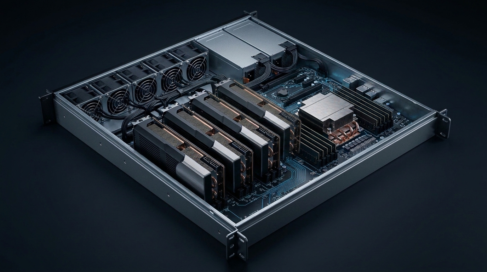
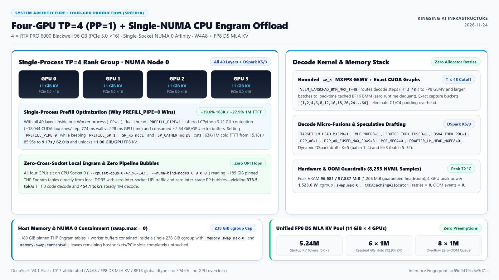
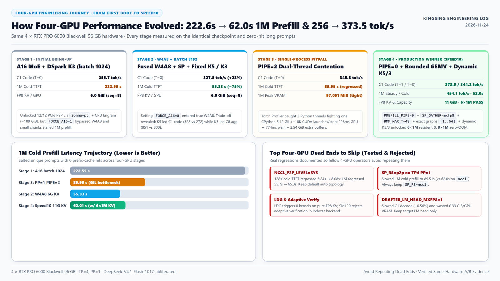
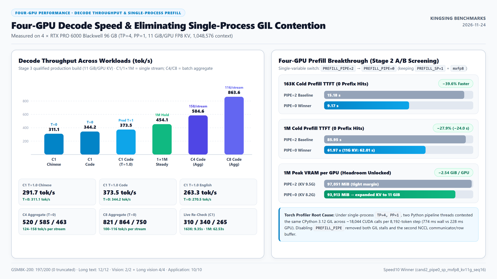
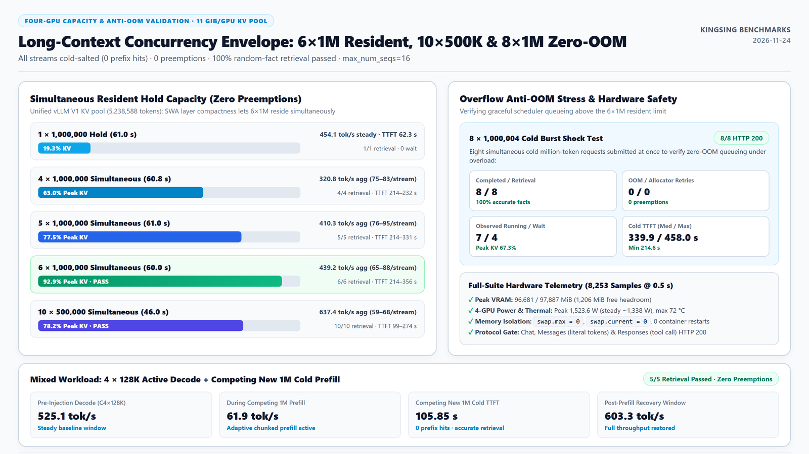

# Four-GPU DeepSeek-V4.1-Flash-1017 Engineering Guide: Reaching 373 tok/s Code Output, 454 tok/s 1M Decode and 6×1M Concurrency on 4× RTX PRO 6000 Blackwell

[Original publication: KINGSING Company News](https://www.kingsing.com/news/KINGSING_DeepSeek_V41_Four_GPU_RTX_PRO_6000_Deployment.html) · [中文完整实战指南](four-gpu-deployment-zh.md)

Deploying `DeepSeek-V4.1-Flash-1017` with its full **1,048,576-token** context window on **four 96 GB PCIe 5.0 GPUs (`384 GB` total VRAM)** is a tight systems-engineering balancing act: model weights, CPU-offloaded Engram tables, MoE quantization kernels, speculative drafting, CUDA graphs, and KV cache all compete for the exact same memory and PCIe/CPU budgets.

This guide documents the complete, verified path KINGSING used to take **4 × NVIDIA RTX PRO 6000 Blackwell Server Edition 96 GB** from initial bring-up (`255.7 tok/s` code, `222.55 s` 1M cold prefill, `6 GiB/GPU` KV) to our promoted **Speed10** production profile: **373.5 tok/s** single-stream code decode (`T=1.0`), **454.1 tok/s** sustained 1M decode, **9.17 s / 62.01 s** cold prefill (`163K / 1M`), **6×1M simultaneous resident sessions** (`439.2 tok/s`), **10×500K simultaneous sessions** (`637.4 tok/s`), and **8×1M cold burst overflow queueing with zero OOMs**. Just as importantly, it publishes every historical dead end we measured so teams running the same 4-GPU hardware can skip straight to a proven configuration.

> **Evaluation Disclosure:** All measurements evaluate `deepseek-ai/DeepSeek-V4.1-Flash-1017` (official release) under strict zero-degradation guardrails (`W4A8` experts, `fp8_ds_mla` KV, `BF16` global dtype, zero FP4 KV, zero GPU overclocking). Official original weights; refusal rates were not evaluated.

---

## 1. Hardware & OS Foundation: Getting Four PCIe 5.0 GPUs Ready

Before tuning a single vLLM flag, three host-level prerequisites determine whether a 4-GPU Blackwell PCIe node runs at full speed or stalls silently:

1. **Unlock PCIe Peer-to-Peer (`iommu=pt`)**: On stock Linux boot settings, our CUDA peer-access test failed across **12 of 12** GPU-to-GPU directions. Adding `iommu=pt` (IOMMU passthrough) to GRUB and rebooting immediately resolved all **12/12 directions** with zero errors, enabling `VLLM_ALLREDUCE_USE_FLASHINFER_PCIE_IPC=1`, `VLLM_MOET_P2P_AR=1`, and `VLLM_MOET_P2P_AG=1`.
2. **Pin Everything to One Local NUMA Node (`NUMA 0`)**: Mount all four GPUs under the same CPU root complex and strictly pin both the Docker container (`--cpuset-cpus=0-47,96-143`) and vLLM workers (`--numa-bind --numa-bind-nodes 0 0 0 0`). With `--engram-config '{"cpu_offload": true, "use_thp": true}'`, the ~189 GiB Engram embedding tables sit in Transparent Huge Pages directly attached to Socket 0 DDR5—eliminating inter-socket UPI latency and pipeline bubbles.
3. **Enforce Zero-Swap Containment (`MemorySwapMax=0`)**: Cap the serving container at `238 GiB` RAM and verify `memory.swap.max=0` / `memory.swap.current=0` at the systemd cgroup level (re-checking after daemon reloads). If Linux ever starts paging pinned Engram memory to swap, tail latency collapses.

---

## 2. How We Got Here: Four-Stage Optimization Journey

Rather than showing only the final numbers, here is the exact chronological trajectory on the same four GPUs—showing where each big gain came from and where an intuitive optimization actually backfired:

| Stage | Key Configuration | C1 Code (`T=0`) | 1M Cold TTFT (0 hits) | FP8 KV / GPU | Key Takeaway |
|---|---|---:|---:|---:|---|
| **Stage 1: Initial Bring-up** | `A16` MoE, `K3`, `batch=1024`, `6 GiB KV` | 255.7 tok/s | 222.55 s | 6.0 GiB (`seq=8`) | `iommu=pt` + CPU Engram worked, but `FORCE_A16=1` bypassed W4A8 and small prefill chunks stalled 1M |
| **Stage 2: W4A8 + Batch 8192** | `FORCE_A16=0`, `batch=8192`, `SP=1`, fixed `K5` / `K3` | 327.8 tok/s (`+28%`) | 55.33 s (`−75%`) | 6.0 GiB (`seq=8`) | True W4A8 + 8192 chunks delivered massive prefill & C1 jump; fixed K forced a C1-vs-C8 trade-off |
| **Stage 3: Single-Process `PIPE=2` Pitfall** | `TP=4, PP=1` + `PREFILL_PIPE=2`, `9.5 GiB KV` | 345.8 tok/s | **85.95 s (regressed)** | 9.5 GiB (tight) | Two Python threads fought one CPython 3.12 GIL (~18,044 CUDA launches/step: 228ms GPU → 774ms wall) + 2.54 GiB extra buffers |
| **Stage 4: Speed10 Production Winner** | **`PREFILL_PIPE=0` + `SP=1` + `GATHER=mxfp8` + `BMM_MAX_T=48` + exact graphs `[1..64]` + dynamic `K5/3`** | **344.2 (`T=1.0`: 373.5)** | **62.01 s** (`163K: 9.17 s`) | **11.0 GiB (`seq=16`)** | Eliminated GIL stall, reclaimed `2.54 GiB/GPU`, hit **`454.1 tok/s`** 1M steady decode & **`6×1M` resident** |

---

## 3. Deep Dive: The Six Techniques That Made Four GPUs Fly

### 3.1 Turning Off `PREFILL_PIPE=2` on Single-Process `PP=1`
In `TP=4, PP=1`, a single Python worker process holds all 40 layers. Torch Profiler showed that enabling `VLLM_MOET_PREFILL_PIPE=2` launched two pipeline threads that serialized on the same CPython 3.12 GIL across **~18,044 CUDA runtime calls per 8,192-token step**, turning `228 ms` of real GPU compute into `774 ms` of wall clock while consuming `~2.54 GiB/GPU` for duplicate row buffers and a second NCCL communicator. Setting **`VLLM_MOET_PREFILL_PIPE=0`** while keeping **`VLLM_MOET_PREFILL_SP=1`**, **`SP_RS=nccl`**, and **`SP_GATHER=mxfp8`** cut 163K/1M cold TTFT by **`−39.6% / −27.9%`** (`15.18s → 9.17s`, `85.95s → 61.97–62.01s`) and freed enough VRAM to grow FP8 KV to **`11.00 GiB/GPU`**.

### 3.2 Verifying True W4A8 Execution (`VLLM_B12X_MOE_FP4_FORCE_A16=0`)
Setting `VLLM_MOET_B12X_MOE_FUSED=1` and `VLLM_MOET_B12X_MOE_PREFILL_FAST=1` does **nothing** if `VLLM_B12X_MOE_FP4_FORCE_A16=1` remains set in your environment—vLLM silently routes through `B12X_MXFP4_BF16` instead of `B12X_MXFP4_MXFP8`. Always verify both the operator self-test (`175/175` checks) and runtime kernel logs. Similarly, when launching `vllm.entrypoints.openai.api_server` directly, pass `"indexer_tp_shard_min_rows": 2048` inside `--attention-config` rather than relying on wrapper env vars.

### 3.3 Bounded `wo_a` MXFP8 GEMV (`VLLM_LANGCHAO_BMM_MAX_T=48`)
FP8 GEMV beats BF16 BMM by `1.24×–2.09×` on small decode batches (`T ≤ 48`) but loses once `T` crosses `56`. Bounding GEMV at `VLLM_LANGCHAO_BMM_MAX_T=48` and serving `T > 48` from a load-time cached BF16 weight captures full single- and multi-stream decode speed with zero runtime dequantization.

### 3.4 Dynamic DSpark Speculation (`[[1,4,5],[5,32,3]]`)
Earlier fixed-K A/B testing proved a clear split: fixed `K=5` pushed C1 code to `327.8 tok/s` (vs. `272.4` on `K=3`), whereas fixed `K=3` pushed C8 aggregate to `851.0 tok/s` (vs. `800.1` on `K=5`). Dynamic DSpark (`K=5` for batches `1–4`, `K=3` for batches `5–32`) with `standard` rejection sampling captures both regimes automatically.

### 3.5 Exact CUDA Graph Buckets + Aligned `max_num_seqs=16`
Capturing exact decode sizes `[1, 2, 4, 6, 8, 12, 16, 18, 20, 24, 28, 32, 36, 40, 44, 48, 52, 56, 60, 64]` with `VLLM_LANGCHAO_GRAPH_AUDIT=0` eliminates the `33%` padding waste of default 8-step buckets (`6→8` at C1, `12→16` at C2, `18→24` at C3). Setting `max_num_seqs=16` aligns seamlessly with `max_cudagraph_capture_size=64` (`16 × (1 + K=3) = 64`), protecting KV VRAM headroom.

### 3.6 Adaptive Fair Prefill (`2048`)
Adding `--long-prefill-token-threshold 2048 --long-prefill-token-threshold-adaptive` prevents interactive users from stalling behind long cold documents: in our controlled concurrency check (injecting a short request 1 second after starting a 128K cold prefill), short-request TTFT dropped from **`26.5 s` to `0.67 s`**, and total completion fell from `30.8 s` to `10.4 s`.

---

## 4. Stage 2 Candidate Screening & Stage 3 Production Benchmarks

### Stage 2 Same-Hardware A/B Screening

| Candidate Profile | Key Experimental Variable | C1 Geo (T=0) | C4 Geo (T=0) | 163K Cold TTFT | 1M Cold TTFT | 1M Peak VRAM | Decision |
|---|---|---:|---:|---:|---:|---:|---|
| `cand1_base_pipe2nccl` | `PIPE=2, ORDER=comm2prio, KV=9.5G` | 303.75 tok/s | 524.11 tok/s | 15.18 s | 85.95 s | 97,051 MiB | Reference (GIL-bound) |
| **`cand2_pipe0_sp_mxfp8`** | **`PIPE=0, SP=1, SP_GATHER=mxfp8`** | **307.62 tok/s** | **526.82 tok/s** | **9.17 s** | **61.97 s** | **93,913 MiB** | **Promoted → KV expanded to 11 GiB** |
| `cand3_pipe2_sharedtail_replay` | `PIPE=2 + SHARED_TAIL=1 + REPLAY_GRAPHS=1` | 303.24 tok/s | 503.62 tok/s | 15.17 s | 85.42 s | 96,453 MiB | Rejected (still GIL-bound; C4 regressed) |
| `cand4_sp_rs_p2p` | `SP_RS=p2p + PIPE_P2P_PREWARM=1` | 306.50 tok/s | 530.77 tok/s | 14.11 s | 89.51 s | 96,269 MiB | Rejected (1M prefill regressed; kept `nccl`) |
| `cand5_drafter_lmhead8` | `DRAFTER_LM_HEAD_MXFP8=1` | 302.03 tok/s | 525.72 tok/s | 14.18 s | 84.09 s | 96,143 MiB | Rejected (C1 −0.56%; +0.33 GiB VRAM) |

### Stage 3 Qualified Production Throughput (`11.00 GiB/GPU` KV)

| Workload | Chinese | Code | English | Notes |
|---|---:|---:|---:|---|
| **C1 single-stream (`T=1.0`, prod default)** | **291.67 tok/s** (`297.15` Stage 2) | **373.51 tok/s** (`366.52` Stage 2) | **263.33 tok/s** (`262.20` Stage 2) | `temperature=1.0, top_p=1.0`, DSpark K=5 |
| **C1 single-stream (`T=0`, deterministic)** | **311.07 tok/s** | **344.20 tok/s** | **270.51 tok/s** | Live post-promotion check: `309.9 / 340.1 / 264.7` |
| **C4 batch aggregate (`T=0`)** | **519.83 tok/s** (`141.0`/stream) | **584.61 tok/s** (`157.9`/stream) | **462.54 tok/s** (`123.7`/stream) | Stage 2 repeat: `521.5 / 589.8 / 475.3` |
| **C8 batch aggregate (`T=0`)** | **821.43 tok/s** (`110.7`/stream) | **863.64 tok/s** (`115.6`/stream) | **749.96 tok/s** (`99.6`/stream) | Stage 2 repeat: `820.1 / 881.3 / 777.1` |
| **1×1M sustained decode (`61.0 s` hold)** | — | **454.11 tok/s** | — | Cold TTFT `62.31 s` · Peak KV `19.3%` · 1/1 retrieval |
| **Single cold prefill TTFT (`0` hits)** | **163K: 9.17 s** (`9.35 s` live) | **1M: 62.01 s** (`62.53 s` live) | — | Salted prompts · 100% fact retrieval passed |

---

## 5. Long-Context Concurrency Envelope & Anti-OOM Validation

At startup, `11.00 GiB/GPU` FP8 DS MLA KV reports `5,238,588 tokens` (`5.00×` nominal at 1M). Because vLLM V1 manages full-attention and sliding-window-attention (SWA) blocks inside one unified pool, each steady 1M request consumes ~15.3% of KV blocks—allowing **6 simultaneous 1M contexts** to reside together with zero preemptions:

| Concurrency Test (All Cold, 0 Prefix Hits) | Hold Window | Aggregate Decode | Per-Stream Range | Cold TTFT (Min / Med / Max) | Peak KV | Result |
|---|---:|---:|---:|---:|---:|---|
| **`1 × 1,000,000`** | 61.0 s | **454.1 tok/s** | 454.1 tok/s | 62.31 s | 19.3% | **PASS** (1/1 retrieval, 0 preemptions) |
| **`4 × 1,000,000`** | 60.8 s | **320.8 tok/s** | 74.6–83.4 tok/s | 214.3 / 228.3 / 232.1 s | 63.0% | **PASS** (4/4 retrieval, 0 wait, 0 preemptions) |
| **`5 × 1,000,000`** | 61.0 s | **410.3 tok/s** | 76.4–95.4 tok/s | 214.5 / 232.8 / 331.1 s | 77.5% | **PASS** (5/5 retrieval, 0 preemptions) |
| **`6 × 1,000,000`** | 60.0 s | **439.2 tok/s** | 64.8–88.1 tok/s | 214.5 / 235.6 / 355.6 s | **92.9%** | **PASS** (6/6 retrieval, 0 preemptions) |
| **`10 × 500,000`** | 46.0 s | **637.4 tok/s** | 59.1–68.2 tok/s | 99.5 / 210.1 / 273.6 s | 78.2% | **PASS** (10/10 retrieval, 0 preemptions) |
| **`8 × 1,000,004` Overflow Burst** | Complete | — | — | 214.6 / 339.9 / 458.0 s | 67.3% | **PASS** (`8/8` HTTP 200, `max_run=7`, `max_wait=4`, **0 OOM**) |

Under a **mixed workload** (`4 × 128K` active decode + sudden cold `1 × 1M` prefill injection), aggregate decode ran at `525.1 tok/s` pre-injection, throttled cleanly to `61.9 tok/s` while the new 1M request achieved `105.85 s` TTFT, and recovered to **`603.3 tok/s`** afterward (`5/5` retrieval, zero preemptions).

---

## 6. Historical Dead Ends & Pitfalls to Avoid on Four GPUs

Every negative result below was measured on the exact same 4-GPU server so you don't waste hours re-discovering them:

1. **`VLLM_MOET_PREFILL_PIPE=2` under `PP=1`**: Single-process CPython GIL contention slowed 163K/1M cold prefill to `15.18s / 85.95s` and burned `~2.54 GiB/GPU`. Always set **`PREFILL_PIPE=0`** on `PP=1`.
2. **`VLLM_B12X_MOE_FP4_FORCE_A16=1`**: Silently bypasses W4A8 fused MoE even when fused flags are enabled. Verify `FORCE_A16=0` and inspect kernel startup logs.
3. **`NCCL_P2P_LEVEL=SYS`**: Forced `SYS` regressed 128K cold TTFT from `6.84 s → 8.08 s` and 1M from `55.73 s → 65.28 s`. Leave NCCL topology auto-detection alone.
4. **`VLLM_MOET_PREFILL_SP_RS=p2p` + `PIPE_P2P_PREWARM=1`**: Regressed 1M cold prefill to `89.51 s`. Keep `SP_RS=nccl`.
5. **`VLLM_MOET_DRAFTER_LM_HEAD_MXFP8=1`**: Slowed C1 (`−0.56%`) and consumed `+0.33 GiB/GPU` VRAM. Quantize only the target LM head (`TARGET_LM_HEAD_MXFP8=1`).
6. **`LDG` switch on pure FP8 KV**: Kernel-level trace audits across 8 traces (C1/C8 × TP4) proved **0 LDG kernels** executed (LDG requires mixed FP8/FP4 KV).
7. **`enable_adaptive_verification=true` on Blackwell SM120**: `DeepseekV41IndexerBackend` only supports query-length mismatch on ROCm/SM90/SM100 and rejects SM120.
8. **CPU `performance` governor & `stream_interval=4`**: A 75-request A/B/A/B/A test showed only `0.1–0.2%` draft-rate noise with inconsistent direction; `stream_interval=4` regressed end-to-end code throughput by `−2.12%` (and inflated naive client-side SSE timing).
9. **Fixed `K=4` and `block` rejection**: `K=4` (`252 / 290 / 241 tok/s`) lost to dynamic `K5/3`; `block` rejection (`267 / 322 / 242`) showed no reliable win over `standard`.

---

## 7. Full Quality, Multimodal & Hardware Safety Qualification

| Verification Gate | Result | Notes |
|---|---|---|
| **GSM8K fixed 200-question subset (`1,024` budget, chat)** | **197 / 200** | `0` truncated; failed IDs `[380, 515, 1019]` |
| **Deterministic authored short tasks (chat / low)** | **29/30 / 30/30** | Batch `c=10`: `28/30` & `30/30` |
| **Production sampling quality (`T=1.0`, 90 tasks)** | **81/90** (repeats `79, 82, 81`) | Initial run included 3 equation-format matches (`84/90` value-correct); matches `79–84/90` variance |
| **Long-context reasoning (`long_quality`, cold)** | **12 / 12** | Includes two 1M-token exact arithmetic tasks |
| **Application & multimodal vision** | **App 10/10 · Short 2/2 · Long 4/4** | Long vision verified at `19,037` prompt tokens |
| **Public HTTPS & three-protocol verification** | **Accept 10/10 · Cold Cancel 3/3** | Chat, Anthropic Messages (literal tokens) & OpenAI Responses (tool calls) all HTTP 200 |
| **Hardware telemetry (`8,253` NVML samples @ `0.5 s`)** | **Peak 96,681 MiB · 1,523.6 W · 72 °C** | `1,206 MiB` free VRAM · `0` allocator retries · `0` OOMs · `swap.max=0 / swap.current=0` |

### Supporting Assets & Reproducibility Scope

- Built on `vLLM 0.32.1rc1.dev117+gdf3bd094a` and `PyTorch 2.14.0+cu130` with Moet kernels, bounded `wo_a` GEMV/BF16-BMM dispatch, and CLI protocol patches—not a full from-scratch vLLM/PyTorch rebuild.
- [Sanitized 4-GPU benchmark & capacity dataset](../data/2026-11-23-four-gpu-speed10.json) · [Sanitized 4-GPU configuration snapshot](../configs/2026-11-23-four-gpu-speed10.json) · [Offline verifier](../tools/verify_4gpu_benchmarks.py).
