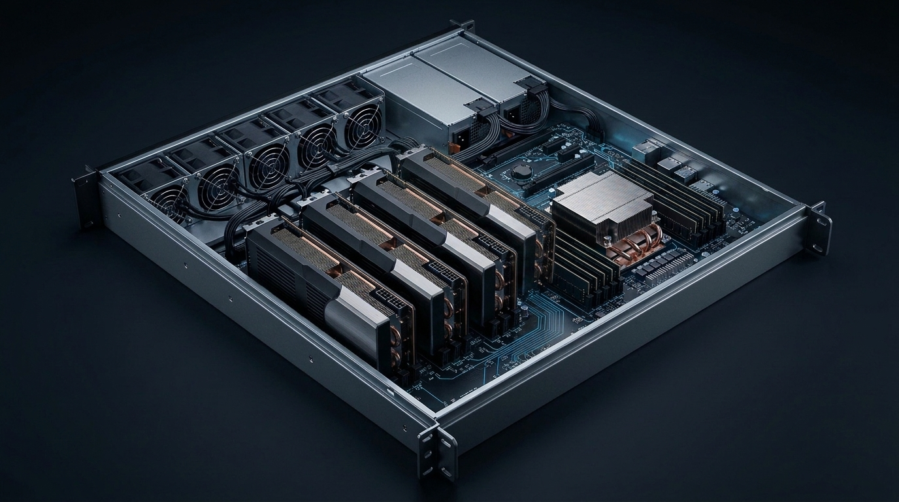
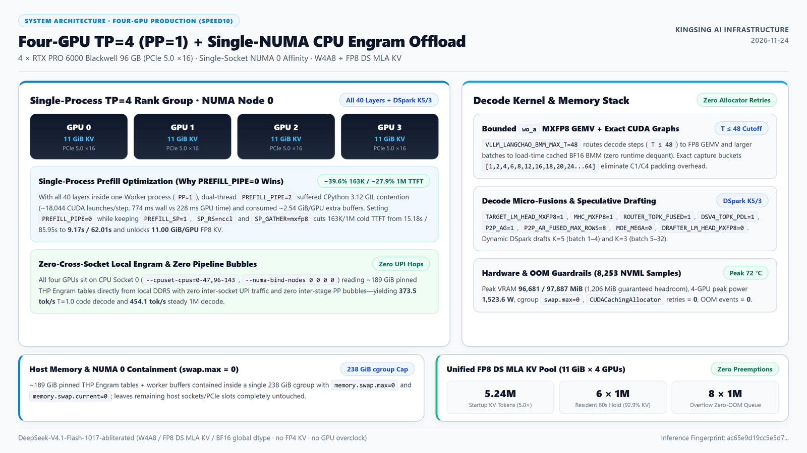
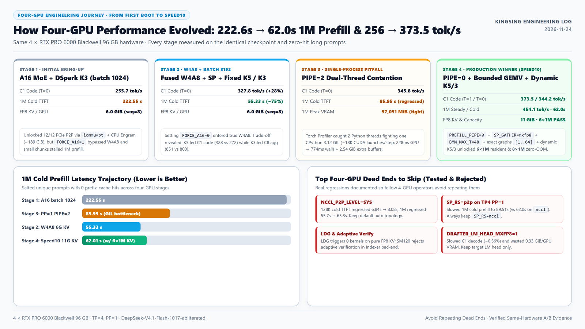
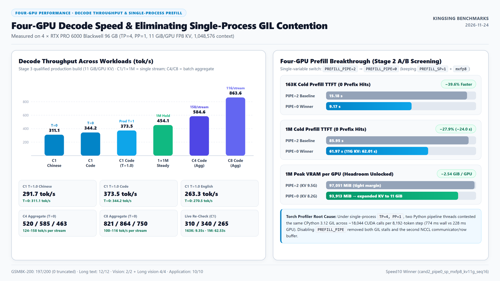
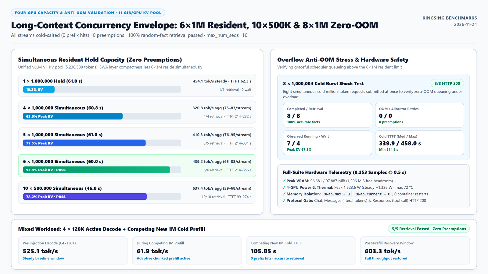

# 四卡 RTX PRO 6000 Blackwell 部署 DeepSeek-V4.1-Flash-1017 完整实战指南与避坑手册

[KINGSING 官网英文原文](https://www.kingsing.com/news/KINGSING_DeepSeek_V41_Four_GPU_RTX_PRO_6000_Deployment.html) · [Full English Engineering Guide](four-gpu-deployment-en.md)

在 **4 张 96 GB PCIe 5.0 显卡（总显存 384 GB）** 上部署支持完整 **1,048,576 上下文** 的 `DeepSeek-V4.1-Flash-1017`，是一场对显存余量、PCIe 通信、CPU Engram 卸载、Python 调度开销与 KV Cache 池化能力的极限平衡。

本文面向所有拥有 **4 × NVIDIA RTX PRO 6000 Blackwell 96 GB** 的开发者与基础设施团队，完整复盘我们如何将四卡节点从最初上线时的 `255.7 tok/s` 代码速度、`222.55 s` 百万冷首字，一步步调优到如今的 **Speed10 生产终版**：**`373.5 tok/s` 代码生成（T=1.0）、`454.1 tok/s` 百万上下文稳态解码、`9.17s / 62.01s` 冷首字、`6×1M` 并发驻留、`10×500K` 并发驻留与 `8×1M` 超限零 OOM**；同时如实公开我们踩过的 **9 个四卡死胡同与反退参数**，帮你省下上百小时无效试错。

> **评测声明**：本文全部数据基于官方原始权重 `deepseek-ai/DeepSeek-V4.1-Flash-1017`（official release），严格坚守 `W4A8` 专家、`fp8_ds_mla` KV、`BF16` 全局权重、零 FP4 KV、零超频的精度底线；未评测拒答率。

---

## 1. 硬件与操作系统底层准备（照搬即可避开 80% 初期故障）

在调任何 vLLM 参数之前，先把这三项宿主机底层做扎实：

1. **GRUB 开启 `iommu=pt` 解锁 PCIe P2P 互访**：默认内核配置下，CUDA 显存直访核验在 4 张卡的 **12/12 个方向全部失败**；配置 `iommu=pt` 重启后 **12/12 方向零错误**，才能真正发挥 `VLLM_ALLREDUCE_USE_FLASHINFER_PCIE_IPC=1`、`VLLM_MOET_P2P_AR=1` 与 `P2P_AG=1` 的 PCIe 5.0 带宽。
2. **严格绑定单路 NUMA 0（零跨 Socket 跳转）**：将 4 张卡全部置于同一 CPU Socket 0 下，容器绑定 `--cpuset-cpus=0-47,96-143`，vLLM 绑定 `--numa-bind --numa-bind-nodes 0 0 0 0`。配合 `--engram-config '{"cpu_offload": true, "use_thp": true}'`，约 `189 GiB` 锁页 THP Engram 嵌入表就近驻留本地 DDR5，零跨路 UPI 延迟、零流水线气泡。
3. **cgroup 零 Swap 铁律**：给容器设定 `238 GiB` 内存上限并在 systemd scope 显式强制 `MemorySwapMax=0`（验证 `swap.max=0` 且 `swap.current=0`），杜绝 Engram 锁页内存被换出引发的延迟雪崩。

---

## 2. 四阶段演进复盘：从 222.6s 冷首字到 373.5 tok/s 与 6×1M

| 演进阶段 | 核心配置 | C1 代码 (T=0) | 1M 冷首字 (0 命中) | FP8 KV / 卡 | 核心教训与突破 |
|---|---|---:|---:|---:|---|
| **阶段 1：初期点亮** | `A16` MoE + `K3` + `batch=1024` | 255.7 tok/s | 222.55 s | 6.0 GiB (`seq=8`) | 打通 `iommu=pt` P2P 与 CPU Engram，但 `FORCE_A16=1` 绕过了 W4A8，小块预填充极慢 |
| **阶段 2：解锁 W4A8 + 8192 块** | `FORCE_A16=0` + `batch=8192` + `SP=1` + 固定 `K5/K3` | 327.8 tok/s (`+28%`) | 55.33 s (`−75%`) | 6.0 GiB (`seq=8`) | 真正进入 W4A8 融合内核；验证了 K5 单路快（328 vs 272）而 K3 八路快（851 vs 800） |
| **阶段 3：`PIPE=2` 单进程踩坑** | `TP=4, PP=1` 开启 `PREFILL_PIPE=2` | 345.8 tok/s | **85.95 s（反退）** | 9.5 GiB（极紧） | Torch Profiler 揪出双线程争用单一 CPython 3.12 GIL（~18,044 次 CUDA 启动，228ms GPU 拖成 774ms）且多占 `2.54 GiB/卡` |
| **阶段 4：Speed10 生产终版** | **`PREFILL_PIPE=0` + `SP=1` + `GATHER=mxfp8` + `BMM_MAX_T=48` + 精确 Graph `[1..64]` + 动态 `K5/3`** | **344.2（T=1.0: 373.5）** | **62.01 s**（`163K: 9.17s`） | **11.0 GiB (`seq=16`)** | 消除 GIL 争用并释放 `2.54 GiB/卡` 扩容 KV，达成 **`454.1 tok/s`** 1M 稳态解码与 **`6×1M`** 并发驻留 |

---

## 3. 六大核心技术拆解（每一项都有实测依据）

1. **单进程 `PP=1` 必须设 `VLLM_MOET_PREFILL_PIPE=0`**：当全部 40 层在同一 Python 进程执行时，关闭双线程流水线（同时保留 `PREFILL_SP=1`、`SP_RS=nccl`、`SP_GATHER=mxfp8`）使 163K/1M 冷首字直降 **`-39.6% / -27.9%`**（`15.18s → 9.17s`、`85.95s → 61.97–62.01s`），单轮冷启立省 24 秒，并腾出 `2.54 GiB/卡` 显存直接用于扩容 KV 池。
2. **显式核验 `VLLM_B12X_MOE_FP4_FORCE_A16=0` 与 `--attention-config`**：环境变量写了 `FUSED=1` 不代表进了融合算子——必须确认 `FORCE_A16=0` 并核对运行时日志确实走入 `B12X_MXFP4_MXFP8`；直接启动 `api_server` 时，必须把 `"indexer_tp_shard_min_rows": 2048` 写入 `--attention-config` 而非仅设环境变量。
3. **分段有界 `wo_a` MXFP8 GEMV（`VLLM_LANGCHAO_BMM_MAX_T=48`）**：小中批量（`T ≤ 48`）走极速 FP8 GEMV，大批量（`T > 48`）无缝切至加载期缓存的 BF16 BMM（零运行时反量化），兼顾单路与多路吞吐。
4. **动态投机采样 DSpark `[[1,4,5],[5,32,3]]`**：1–4 并发自动用 `K=5`（把单流代码推到 `373.5 tok/s`），5 并发以上自动切 `K=3`（守住高并发聚合效率），鱼与熊掌兼得。
5. **精确 CUDA Graph 捕获桶 `[1,2,4,6,8,12,16,18,20,24...64]` + `max_num_seqs=16`**：彻底消除默认 8 步进在 C1（6→8，浪费 33% 算力）等日常并发下的空转；`16 × (1 + K=3) = 64` 严丝合缝对齐最大图捕获上限 `64`，把宝贵显存全留给 11 GiB/卡 KV 池。
6. **自适应公平预填充（`--long-prefill-token-threshold 2048 --long-prefill-token-threshold-adaptive`）**：实测 128K 长文冷预填充启动 1 秒后插入短请求，短请求首字等待从 **`26.5 s` 骤降至 `0.67 s`**，整请求完成耗时从 `30.8 s` 降至 `10.4 s`。

---

## 4. 并发容量实测（`6×1M` 驻留、`10×500K` 与 `8×1M` 零 OOM）

虽然 `11.00 GiB/卡` KV 池在启动日志里按全注意力层标称 `5,238,588 tokens (5.00×)`，但 vLLM V1 统一物理块池充分利用了 SWA 层的低块占用，单路 `1M` 稳态实际仅占约 `15.3%` KV 块：

| 压测场景（全部冷加盐，0 前缀命中） | 共同保持时长 | 稳态聚合吞吐 | 单流区间 | 冷首字（最小 / 中位 / 最大） | 峰值 KV 占比 | 结果 |
|---|---:|---:|---:|---:|---:|---|
| **`1 × 1M` 单路长文** | 61.0 s | **454.1 tok/s** | 454.1 tok/s | 62.31 s | 19.3% | **通过**（1/1 检索，0 抢占） |
| **`4 × 1M` 同时驻留** | 60.8 s | **320.8 tok/s** | 74.6–83.4 tok/s | 214.3 / 228.3 / 232.1 s | 63.0% | **通过**（4/4 检索，0 等待，0 抢占） |
| **`5 × 1M` 同时驻留** | 61.0 s | **410.3 tok/s** | 76.4–95.4 tok/s | 214.5 / 232.8 / 331.1 s | 77.5% | **通过**（5/5 检索，0 抢占） |
| **`6 × 1M` 同时驻留** | 60.0 s | **439.2 tok/s** | 64.8–88.1 tok/s | 214.5 / 235.6 / 355.6 s | **92.9%** | **通过**（6/6 检索，0 抢占） |
| **`10 × 500K` 同时驻留** | 46.0 s | **637.4 tok/s** | 59.1–68.2 tok/s | 99.5 / 210.1 / 273.6 s | 78.2% | **通过**（10/10 检索，0 抢占） |
| **`8 × 1M` 超限冲击** | 全部完成 | — | — | 214.6 / 339.9 / 458.0 s | 67.3% | **通过**（`8/8` HTTP 200，`max_run=7, max_wait=4`，**0 OOM**） |

混合负载（`C4×128K` 稳态解码 + 突发 `1×1M` 冷预填充）：基线 `525.1 tok/s` → 竞争窗口 `61.9 tok/s`（新 1M 首字 `105.85 s`）→ 恢复 **`603.3 tok/s`**，5/5 精确检索通过、零抢占。

---

## 5. 四卡踩坑与淘汰方案红黑榜（直接帮你省下上百小时）

1. **`PP=1` 开 `VLLM_MOET_PREFILL_PIPE=2`（严重反退）**：双线程争抢单进程 CPython GIL，163K 退到 `15.18s`、1M 退到 `85.95s`，多吃 `2.54 GiB/卡` 显存 → **必须设 `0`**。
2. **遗留 `VLLM_B12X_MOE_FP4_FORCE_A16=1`（静默失效）**：即使开了 `FUSED=1` 仍被绕过 → **必须显式设 `0` 并查日志**。
3. **直启 vLLM 仅传 `INDEXER_TP_SHARD_MIN_ROWS` 环境变量（无效）**：只被上游包装脚本识别 → **必须写进 `--attention-config`**。
4. **强设 `NCCL_P2P_LEVEL=SYS`（反退）**：128K 冷首字从 `6.84s → 8.08s`，1M 从 `55.73s → 65.28s` → **保持默认自动拓扑**。
5. **`VLLM_MOET_PREFILL_SP_RS=p2p`（反退）**：1M 冷首字退化至 `89.51s` → **保持 `nccl`**。
6. **`VLLM_MOET_DRAFTER_LM_HEAD_MXFP8=1`（负收益）**：C1 变慢 `-0.56%` 且多占 `0.33 GiB/卡` → **保持 `0`**（只开 Target LM head）。
7. **纯 FP8 KV 下强开 `LDG`（空转无效）**：8 份 GPU trace 实测新内核调用次数为 `0`（它需要混合 FP8/FP4 KV）。
8. **Blackwell SM120 开 `enable_adaptive_verification=true`（报错拒载）**：Indexer backend 仅支持 ROCm/SM90/SM100 → **保持 `false`**。
9. **CPU `performance` 调频 / `stream_interval=4` / 固定 `K=4` / `block` 拒绝（无收益或反退）**：75 次 A/B/A/B/A 测得调频仅 `0.1–0.2%` 噪声；`stream_interval=4` 代码端到端反降 `-2.12%`；`K=4` 与 `block` 均未胜出 → **保持默认与 `standard` 拒绝**。

---

## 6. 质量、硬件遥测终验与配套文件

- **质量与协议**：GSM8K-200 **`197/200`**（0 截断）、`quality_chat` `29/30`、`quality_low` `30/30`、批处理 `28/30` & `30/30`、`T=1.0` 生产质量 `81/90`（含 3 题等式格式值正确即 `84/90`，3 轮复测 `79/82/81`）、`long_quality` **`12/12`**、`application` **`10/10`**、短图文 `2/2`、长图文 `4/4`（`19,037` tokens）、公开 HTTPS `10/10`、冷取消 `3/3`。
- **硬件安全（`8,253` 次 0.5s NVML 采样）**：峰值显存 `96,681 / 97,887 MiB`（保底余量 `1,206 MiB`），4 卡峰值功耗 `1,523.6 W`，最高温度 **`72 °C`**，`0` OOM、`0` allocator 重试、`swap=0`。
- **离线验证与快照**：[脱敏数据](../data/2026-11-23-four-gpu-speed10.json) · [配置快照](../configs/2026-11-23-four-gpu-speed10.json) · `python tools/verify_4gpu_benchmarks.py`。
